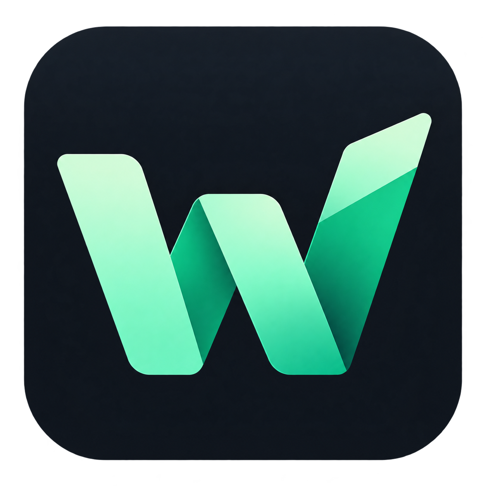

<div align="center">
  

# Winit

**Your PC. Your way.**

A portable Windows app and utility manager, built with Rust and a native Slint interface.

[Get started](#get-started) · [Usage](#usage) · [Profiles](#profiles) · [Development](#development) · [Troubleshooting](#troubleshooting)

</div>

Install apps in batches with Winget, prepare a PC from JSON profiles, and organize tools from GitHub Releases, direct URLs, or manual installations. Winit brings favorites, an operation queue, and history together in a Brazilian Portuguese interface with light and dark themes.

## Features

| Area | What it does |
| --- | --- |
| Apps | Search Winget, save favorites, install a selection, and add apps to profiles. |
| Installed apps and updates | Combine Winget and Windows registry inventory; update or uninstall Winget-managed packages. Registry-only entries are read-only. |
| Custom catalog | Register GitHub Releases, direct HTTPS downloads, and manual instructions; import and export catalogs as JSON. |
| Profiles | Create, edit, duplicate, import, export, and plan a repeatable app setup. |
| Manual tasks | Track outstanding installations by app and profile, mark them complete, or reopen them. |
| Utilities | Browse public GitHub releases and open built-in Windows tools. |
| Operations | Follow a serial queue, view download progress and error details, and retry failed tasks. |

> [!IMPORTANT]
> Only Winget supports automated installation. Custom apps create downloads or manual tasks. Downloading a file or completing a manual task does not verify that an app is installed.

## Get started

### Run the Windows package

Extract `Winit-Windows-x64.zip`, when available, and open **`Winit.exe`** from the extracted folder. In this workspace, the packaged executable is available at `dist/Winit.exe`.

- **System:** Windows 10 or 11 x64. Recorded local validation used Windows 11; see the [validation limitations](docs/CUSTOM_APPS_VALIDATION.md#limites-desta-validação).
- **Winget:** required to search, install, update, and remove packages. Install or update **App Installer** through Microsoft Store and enable the `winget.exe` execution alias for your user account.
- **Network:** catalog queries and downloads require HTTPS. Profiles, manual tasks, and local tools remain available without Winget.

Running the package does not require Rust, Node.js, .NET, or WebView2. Slint uses software rendering, and the MSVC build configuration links the C/C++ runtime statically.

Winit starts with standard user privileges and does not install apps at startup. Windows and each installer handle UAC elevation requests.

### Usage

The interface is in Brazilian Portuguese; the labels below match the app.

1. In **Aplicativos**, enter at least two characters, select packages, and request a batch installation.
2. Use **+ Perfil** to save your selection. In **Meus perfis**, choose **Preparar meu PC** and review the plan before confirming.
3. In **Instalados** and **Atualizações**, review your apps and select the operations to run. Use **Atualizar lista** after changing installed software.
4. In **Meus aplicativos**, choose **+ Adicionar aplicativo** to configure GitHub Releases, a direct URL, or manual installation. **Exemplo: DuoDesk** adds a sample without overwriting an existing registration.
5. Follow execution in **Operações** and manual installations in **Pendências**. For downloaded files, use **Abrir pasta** or confirm opening the installer.

Tasks run sequentially. Pending tasks and active downloads can be canceled; an installer that has already started must be canceled through the installer itself. Normal window closing is blocked while the queue is active.

## Profiles

The built-in **Essenciais** profile includes Firefox, 7-Zip, Visual Studio Code, and VLC. Profiles reference apps rather than bundling their installers:

```json
{
  "schema_version": 1,
  "name": "My setup",
  "description": "Editor and archive manager",
  "packages": [
    { "provider": "winget", "id": "Microsoft.VisualStudioCode" },
    { "provider": "winget", "id": "7zip.7zip" }
  ]
}
```

Edit and validate JSON in **Meus perfis**, or import a file through the native dialog. Remove a package by deleting its object from `packages`. Each profile supports up to 500 packages and 1 MB, including embedded definitions.

**Preparar meu PC** queries Winget again, skips installed IDs, and presents installations, downloads, and manual tasks before confirmation. Winget installations use `--no-upgrade` to avoid implicitly upgrading an existing package.

Profiles can combine `winget`, `github` (`owner/repository`), and `custom` (registration UUID) references. Exporting through the interface embeds the custom definitions needed to transfer a profile. See [mixed profiles and portability](docs/CUSTOM_APPS.md#perfis-existentes-e-portabilidade), the [Essenciais profile](assets/essentials.json), and the [DuoDesk catalog](assets/duodesk-catalog.json). The detailed guides are currently in Portuguese.

## Downloads and tools

In **Utilitários**, query a public repository using `owner/repository`. The initial integration uses `itsfatduck/optimizerDuck`; Winit fetches current release metadata and does not apply optimizations automatically. Custom GitHub entries also support architecture selection, pre-releases, and filename patterns such as `DuoDesk-Setup-*.exe`.

Downloads accept `.exe`, `.msi`, `.msix`, and `.zip`, with a 4 GB limit. Files are downloaded to temporary paths, checked against their declared size when available, and hashed with SHA-256. Published or configured hashes are compared before completion. Existing files are reused only after that comparison and are never overwritten. Direct URLs do not provide reliable update detection.

> [!NOTE]
> The distributed executable is not code-signed, and Winit does not verify Authenticode signatures on downloads. Opening an installer requires additional confirmation and another hash check. ZIP files are not extracted automatically. Windows remains responsible for SmartScreen and UAC.

Local shortcuts include Task Manager, Disk Management, Device Manager, Services, System Information, DirectX diagnostics, Disk Cleanup, Storage, and Windows Update. Tools that allow system changes display a confirmation before opening.

See [Custom apps](docs/CUSTOM_APPS.md) for asset selection, catalog imports, and manual tracking.

## Settings and data

Theme, favorites, profiles, catalog entries, manual tasks, settings, and history are stored under `%LOCALAPPDATA%\Winit\`:

| File | Purpose |
| --- | --- |
| `state.json` | Current state, using schema 2. |
| `state.backup.json` | State before the last write. |
| `state.v1.backup.json` | Original state preserved when migrating from schema 1. |

For portable storage, create an empty **`portable.flag`** beside the executable or start it with **`--portable`**. Data is then stored in a writable `winit-data/` folder beside the executable. Data from another location is not moved automatically.

**Compatibility with the former AIO Toolkit name:** if the new data directory does not exist, Winit reuses an existing `%LOCALAPPDATA%\AIO Toolkit\` directory, or `aio-data/` in portable mode. It keeps the same data files and instance lock. If both old and new directories exist, the Winit directory takes precedence.

The download folder is configurable and defaults to `%USERPROFILE%\Downloads\Winit`. Existing saved download paths are preserved. Enabling portable mode does not change this preference. Source agreement acceptance for queries and silent installer preferences are available in **Configurações**; installations and updates require explicit agreement acceptance in their confirmation dialog.

Writes use atomic replacement and a backup. Interrupted operations become failed tasks when the app reopens and are never retried automatically. History retains up to 300 completed operations as the queue advances, with the last 16 KiB of stdout/stderr per operation. Only one instance can use a given data directory.

## Development

### Requirements and local execution

Use Windows x64, stable Rust MSVC (**1.92 or later**, as declared in `Cargo.toml`), Visual Studio Build Tools with **Desktop development with C++**, and Windows SDK. From the project root:

```powershell
cargo run --locked
```

Build and run the Windows x64 release:

```powershell
cargo build --locked --release --target x86_64-pc-windows-msvc
.\target\x86_64-pc-windows-msvc\release\winit.exe
```

The project uses Rust 2024, Slint 1.15.1 with the Winit windowing backend, Tokio for asynchronous work, and Reqwest/Rustls for HTTPS. The windowing backend is an external dependency separate from this app. `Cargo.lock` pins dependencies; `.cargo/config.toml` enables `crt-static` for MSVC x64.

### Checks

```powershell
cargo fmt --all -- --check
cargo clippy --locked --all-targets -- -D warnings
cargo test --locked
```

Default tests do not install apps or depend on network access. Optional integration tests query local Winget and GitHub and download temporary files without executing installers. Transfer size depends on available releases: approximately 90 MB for `live_providers` and 200 MB for `custom_downloads_live` in the recorded validation.

```powershell
cargo test --locked --test live_providers -- --ignored --nocapture
cargo test --locked --test custom_downloads_live -- --ignored --nocapture
```

The interface self-test opens the Slint window, queries real providers, and exercises callbacks without installing or removing apps. Screenshots and `result.json` are saved in an isolated session under `target/qa/`:

```powershell
cargo run --locked -- --self-test
```

The [Windows x64 workflow](.github/workflows/windows.yml) checks formatting, Clippy, and tests, builds the release, and uploads an artifact containing the executable, documentation, examples, and SHA-256 checksum. Publishing a GitHub Release is a separate step. The [recorded 0.2.0 validation](docs/CUSTOM_APPS_VALIDATION.md) describes local checks performed before the Winit rename and their limitations.

### Project structure

```text
src/
  app/              UI controller, models, and self-test
  domain/           Packages, profiles, catalog, and operation states
  infrastructure/   Processes, persistence, and system information
  providers/        Winget, GitHub, Windows, and custom catalog integrations
  services/         Planning, queue, downloads, catalog, and manual tasks
  ui/app.slint      Screens, components, and dialogs
assets/             Icons, Windows manifest, and JSON examples
tests/              Domain, operation, and optional integration tests
docs/               Detailed guides and validation reports
```

Providers declare capabilities through `SoftwareProvider`. The queue and services run off the UI thread; model changes use the Slint event loop. Processes receive separate arguments without shell interpolation. The Winget integration adapts textual CLI output and rejects unrecognized formats.

## Troubleshooting

| Symptom | What to check |
| --- | --- |
| Winget unavailable | Update App Installer and enable its execution alias. Winit looks for `%LOCALAPPDATA%\Microsoft\WindowsApps\winget.exe`. |
| Query requires source agreements | Review the acceptance preference in Configurações and retry. |
| GitHub returns HTTP 403/429 | Wait before retrying; unauthenticated public API requests may be rate-limited. |
| Release has no matching file or multiple candidates | Check the architecture and asset pattern in Meus aplicativos. Profile planning may offer a manual task. |
| Installer failed | Review stdout, stderr, and the exit code in Operações; check UAC and whether the package supports silent mode. |
| Portable data cannot be saved | Ensure the executable folder and the selected data directory are writable. |
| Invalid `state.json` | Close the app, preserve a copy, and restore `state.backup.json` as `state.json` in the same directory. Invalid state is not overwritten at startup. |

Inventory does not cover every Store/UWP app or standalone portable program. Custom Winget sources, private/authenticated GitHub access, partial download resume, and automatic self-updates are not supported. Real installation, update, removal, and UAC flows still require validation on Windows 10/11 test machines; automated tests do not execute those flows.
